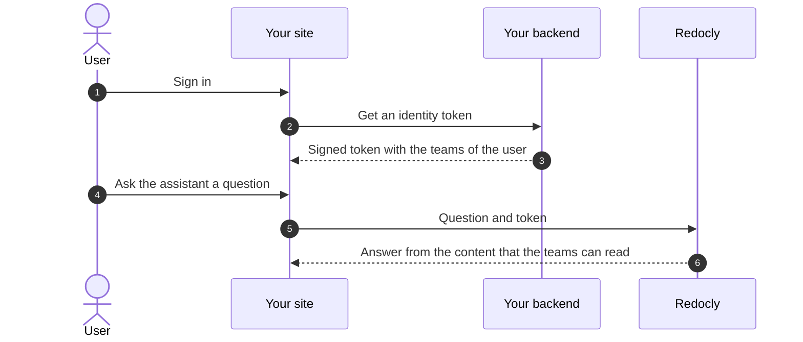

---
products:
  - Redoc
  - Revel
  - Reef
  - Realm
plans:
  - Enterprise+
keywords:
  includes:
    - authentication
    - login
    - JWT
    - JWKS
    - identity token
---

# Answer from login-protected content



By default, the [AI assistant web component](./ai-assistant-web-component.md) uses only the content that anonymous users can read.
To let it use protected content, send an identity token for each user who signs in to your site.

An identity token is a short-lived JSON Web Token (JWT) with the [RBAC](../access/rbac.md) teams of the user.
Your backend creates and signs the token, and Realm checks it with your public key.



If the token is missing or not valid, the assistant answers as an anonymous user.

## Before you begin

Make sure you have:

- [RBAC](../config/access/rbac.md) rules for your content, with the teams that you plan to send in the tokens
- the Maintain or Admin role in the project
- a backend that knows which users signed in to your site

For example, this rule lets only logged-in users read your docs:

```yaml 
access:
  rbac:
    content:
      '**':
        authenticated: read
```

## Set up identity tokens



### Create a key pair

This Node.js script creates an ES256 key pair with the [jose](https://www.npmjs.com/package/jose) library.
Redocly also supports RS256 and EdDSA.

```js 
import { writeFile } from 'node:fs/promises';
import { exportJWK, exportPKCS8, generateKeyPair } from 'jose';

const { publicKey, privateKey } = await generateKeyPair('ES256', {
  extractable: true,
});
const publicJwk = {
  ...(await exportJWK(publicKey)),
  kid: 'acme-2026-10',
  alg: 'ES256',
  use: 'sig',
};

await writeFile('jwks.json', JSON.stringify({ keys: [publicJwk] }, null, 2));
await writeFile('identity-key.pem', await exportPKCS8(privateKey));
```

Keep the private key, `identity-key.pem`, on your backend.
Never send it to the browser.


### Publish the public key

Put the `jwks.json` file on a public HTTPS URL, for example `https://app.acme.com/.well-known/jwks.json`.
The file can be static, so any web server, CDN, or storage bucket can host it.


### Turn on identity verification

1. In Reunite, open your project, and select **Settings** > **AI assistant**.
1. Turn on **Verify signed-in users**.
1. Enter the **JWKS URL**.
1. In **Audience**, enter a value unique to the AI assistant, for example `redocly-ai-assistant`.
1. Select **Save**.


### Create tokens in your backend

Each token needs the audience in the `aud` claim, a short expiration time, and the RBAC teams of the user in the `teams` claim:

```js 
import { readFile } from 'node:fs/promises';
import { importPKCS8, SignJWT } from 'jose';

const pem = await readFile('identity-key.pem', 'utf8');
const privateKey = await importPKCS8(pem, 'ES256');

export function createIdentityToken(user) {
  return new SignJWT({ teams: user.teams })
    .setProtectedHeader({ alg: 'ES256', kid: 'acme-2026-10' })
    .setAudience('redocly-ai-assistant')
    .setExpirationTime('5m')
    .sign(privateKey);
}
```

Return the token from an endpoint that only signed-in users can call, for example `GET /api/assistant-token`.


### Send the token from your page

Give the assistant a function that gets the token from your backend:

```js
window.RedoclyAssistant.setConfig({
  getIdentityToken: async () => {
    const response = await fetch('/api/assistant-token', { credentials: 'include' });
    const { token } = await response.json();
    return token;
  },
});
```

The assistant calls the function before each request, so each request has a valid token.



## Troubleshoot



Open the **Network** tab of the browser developer tools, ask a question, and select the `_ask-ai` request.
The `x-redocly-ai-assistant-identity-status` response header displays the status of the token:

- `ok`: Redocly accepted the token.
- `absent`: the request had no token.
- `invalid`: Redocly rejected the token.
  Check the algorithm, the `aud` claim, the `kid`, and the JWKS URL.
- `expired`: the token expired.


- The teams in the token must match the teams in the RBAC rule of the page exactly.
  Redocly changes the team names in the token to lowercase, so use lowercase team names.
- The assistant uses a changed page or RBAC rule only after the next production deployment.

A token with the wrong teams does not cause an error.
The assistant answers, but without the protected page.



## Resources

- **[AI assistant web component](./ai-assistant-web-component.md)** - Add the assistant to your site
- **[AI assistant web component configuration](./reference.md)** - Every attribute, method, event, and CSS variable of the assistant
- **[Role-based access control](../access/rbac.md)** - Learn how teams and roles control what users can read
- **[AI governance and security FAQ](../faq/ai-governance.md)** - Answers for security and compliance reviews of Redocly AI features
